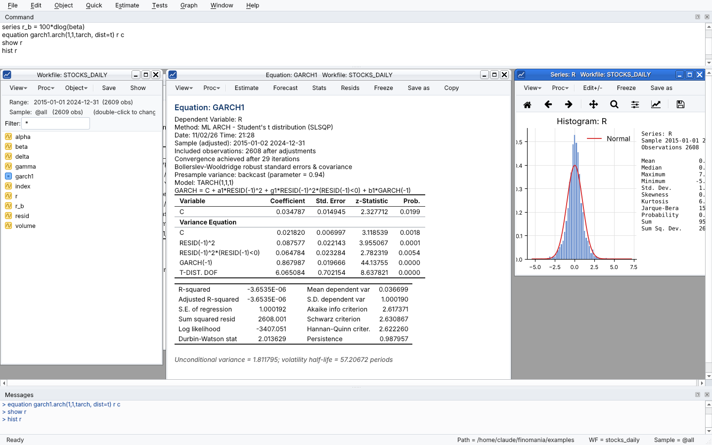
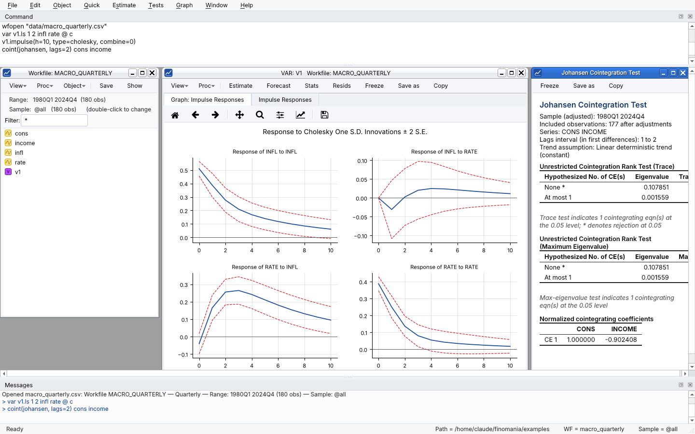
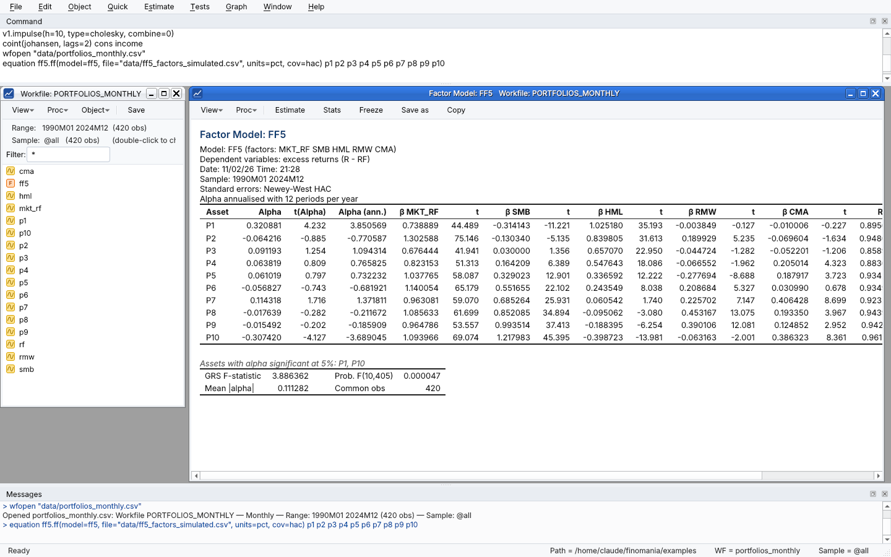

# Finomania

**An open-source, EViews-style econometrics workbench for financial time series and panel data.**

Finomania gives you the EViews way of working: workfiles, a command window, objects with *View* and *Proc* menus, estimation dialogs, frozen tables and program files. It runs on the open scientific Python stack (NumPy, pandas, SciPy, statsmodels, arch, linearmodels, scikit-learn, matplotlib, Qt). Everything you do with the mouse is written to the command window as a command, so every analysis can be saved as a program and rerun.



| | |
|---|---|
|  |  |

*(Screenshots use the simulated demo data shipped in `examples/data`.)*

---

## What it does

| Area | Methods |
|---|---|
| **Data** | Dated (annual, semi-annual, quarterly, monthly, weekly, daily 5/7), undated and **panel** workfiles. Imports CSV, Excel, Stata and Parquet files and detects dates and panel ids automatically. Downloads from **Yahoo Finance**, **FRED** and the **Kenneth French data library**. Has an EViews expression language (`x(-1)`, `d()`, `dlog()`, `@movav`, `@pch`, `@recode`, …), samples with `smpl … if …`, and saves `.fwf` workfiles. |
| **Statistics** | Descriptive statistics, histogram + Jarque-Bera, correlogram (ACF/PACF/Q), correlations with t-tests, normality tests (JB, Shapiro-Wilk, Anderson-Darling, Lilliefors), BDS, Lo-MacKinlay variance ratio, equality tests, PCA. |
| **Single equation** | Least squares with ordinary / White / HAC / clustered covariance, WLS, regression with ARMA errors, NLS (`y = c(1)+c(2)*x^c(3)`), TSLS/IV, GMM, quantile regression (and quantile process), logit/probit, Poisson / negative binomial. |
| **Equation diagnostics** | Actual/fitted/residual graph and table, Breusch-Godfrey LM, Breusch-Pagan-Godfrey / Harvey / Glejser / White / ARCH-LM, RESET, Chow breakpoint, CUSUM / CUSUMSQ, recursive coefficients, Wald tests (nonlinear restrictions by the delta method), omitted / redundant variables, VIF, confidence intervals, static and dynamic forecasts with evaluation statistics. |
| **Time series** | ARIMA/SARIMA, automatic ARMA selection, ETS exponential smoothing, unit roots (ADF, PP, KPSS, DF-GLS, Zivot-Andrews), Johansen / Engle-Granger / Phillips-Ouliaris cointegration, Granger causality, **VAR** (lag selection, block exogeneity, Cholesky / generalized impulse responses, variance decomposition, stability, residual tests, forecasts), **VECM**, **ARDL with Pesaran-Shin-Smith bounds test**, Markov switching, HP / Baxter-King / Christiano-Fitzgerald filters. |
| **ARCH family** | Native maximum-likelihood engine for **GARCH, TARCH/GJR, EGARCH, PARCH/APARCH, Component GARCH, IGARCH**. Supports ARMA mean terms, **ARCH-in-mean** (sd / variance / log variance), exogenous **variance regressors**, and Normal / Student-t / GED / skewed-t errors. FIGARCH, HARCH and EWMA come via `arch`. Covariance: Bollerslev-Wooldridge robust, OPG or Hessian. Views: conditional SD / variance, news impact curve, Engle-Ng sign-bias test, standardized-residual diagnostics, simulation-based mean and volatility forecasts. |
| **Multivariate GARCH** | **CCC, DCC (Engle 2002), asymmetric DCC** with Gaussian or multivariate-t correlation step; **diagonal and scalar BEKK**. Views: conditional correlations and covariances, Engle-Sheppard constant-correlation test, LR test against CCC, correlation forecasts, dynamic hedge ratios, minimum-variance portfolio weights. |
| **Panel data** | Pooled, fixed effects (cross-section / period / two-way), random effects, between, first differences and Fama-MacBeth, with ordinary / White / clustered (1- and 2-way) / Driscoll-Kraay covariance. Tests: redundant fixed effects (F, LR), **Hausman** plus a robust Mundlak version, Breusch-Pagan and Honda LM, Pesaran CD, Wooldridge serial correlation, modified Wald heteroskedasticity. **Arellano-Bond difference GMM and Blundell-Bond system GMM** (one/two-step, **Windmeijer** correction, Hansen/Sargan, AR(1)/AR(2)). Panel unit roots: LLC, IPS, Fisher-ADF/PP, Hadri. Dumitrescu-Hurlin panel causality. |
| **Asset pricing** | **CAPM, Fama-French 3, Carhart 4, FF5, FF6** time-series regressions on many assets (factors downloaded and cached). Reports annualised alphas and information ratios, the **GRS test**, **Fama-MacBeth** with **Shanken** correction and Newey-West, rolling betas and factor statistics. |
| **Machine learning** | **LSTM** forecasting with a built-in NumPy engine (no extra install; stacked layers, Adam, early stopping, gradient-checked). PyTorch is used automatically when installed, and enables GRU. Random forest, gradient boosting, MLP, SVR and ridge comparators. Chronological train/validation/test split, benchmark comparison and a Diebold-Mariano test. |
| **Risk** | VaR / ES (historical, normal, Cornish-Fisher, Student-t, EWMA, GARCH-t, filtered historical simulation). Rolling VaR backtests with Kupiec, Christoffersen and Basel traffic light. Performance analytics: Sharpe, Sortino, drawdowns, Calmar, beta, tracking error, information ratio. |
| **Programming & output** | Program files (`.fprg`) with `for` / `if` / `while`, `!numbers`, `%strings` and `{substitution}`. Every output can be frozen into table / graph objects and exported to HTML, CSV, LaTeX, PNG, PDF or SVG. Batch runs write an HTML report. There is also a Python API for notebooks. |

## Install (Windows)

**Option A: installer (recommended, no Python needed).** Download `Finomania-x.y.z-Setup-win64.exe` from the [Releases page](https://github.com/shaysayswhat/finomania/releases) and run it. You get:
* a Start-menu entry and an optional desktop icon,
* `.fwf` workfiles and `.fprg` programs that open with a double-click,
* a normal uninstaller under *Settings ▸ Apps*.

A portable `.zip` is also published if you'd rather not install: unzip it and run `Finomania.exe`.

**Option B: build the installer yourself.** On any Windows PC with Python 3.10+, double-click **`build_installer.bat`**. It produces:
* `dist\Finomania\Finomania.exe` (the ready-to-run app),
* `installer\Finomania-x.y.z-Setup-win64.exe`. It installs Inno Setup automatically with `winget` if it is missing.

Every build runs the app's built-in self test (`finomania-cli.exe --selftest`).

**Option C: run from source.** Double-click `install.bat` once, then `Finomania.bat`. Optional extras: `.venv\Scripts\pip install torch` (GRU networks and a faster LSTM) and `yfinance` (more robust Yahoo downloads).

Other tools:
* `Finomania-console.bat`: runs from source with a console window that shows error details. `Finomania-console.bat --cli` gives a text command prompt.
* `run_program.bat examples\01_volatility.fprg`: runs a program in batch and writes an HTML report next to it. The installed app has the same feature as *Run in batch* on the right-click menu of `.fprg` files.
* `run_tests.bat`: runs the validation test suite.

**Automatic builds.** `.github/workflows/build-windows.yml` builds the app on GitHub's Windows machines on every push. It runs the tests and the frozen-app self test, builds the installer and the portable zip, and attaches them to a GitHub Release whenever a version tag (`v1.0.0`, …) is pushed.

**macOS / Linux:** `python3 -m pip install -r requirements.txt` and then `./finomania.sh`. Or install as a package with `pip install -e .`, which provides the `finomania` and `finomania-cli` commands. `pyinstaller packaging/finomania.spec` also builds a stand-alone Linux app.

Your work lives in **Documents\Finomania**. The demo programs are copied to `Documents\Finomania\examples` the first time you open *File ▸ Demo programs*. Logs are written to `%LOCALAPPDATA%\Finomania\logs`.

## Quick start

Open **File ▸ Demo programs** and press **Run (F5)**, or type in the command window:

```
wfopen "examples/data/stocks_daily.csv"          ' dates detected automatically
series r = 100*dlog(alpha)                         ' percent log returns
hist r                                             ' histogram + Jarque-Bera
uroot(adf) r
equation eq1.arch(1,1,tarch, dist=t) r c           ' GJR-GARCH with Student-t errors
eq1.nic                                            ' news impact curve
eq1.forecast(h=20)                                 ' mean & volatility forecasts
series r2 = 100*dlog(beta)
equation dcc1.dcc(model=tarch, dist=t) r r2        ' DCC-GARCH
dcc1.corrgraph
```

More examples:

```
' --- macro time series
var v1.ls 1 4 infl rate @ c
v1.impulse(12)
coint(johansen, lags=2) cons income
equation ar1.ardl(maxlag=4) cons income            ' ARDL + bounds test

' --- panels  (firm-year data with columns firm, year, ...)
import(id=firm, date=year) "firm_panel.csv"
equation fe.ls(cx=f, cov=cluster) inv c q cf lev
fe.hausman
equation gmm1.dpd(lags=1, sys=1, endog="cf", collapse=1) inv q cf lev

' --- asset pricing (downloads Ken French factors)
equation ff.ff(model=ff5, freq=m, cov=hac) p1 p2 p3 p4 p5 p6 p7 p8 p9 p10
ff.grs
ff.fmb(nw=3)

' --- machine learning and risk
equation nn.lstm(lookback=20, epochs=100) vol
nn.forecast(h=10)
backtest(level=0.99, window=500, method=garch) r
```

The full command, function and view reference is in [`docs/COMMANDS.md`](docs/COMMANDS.md). You can also type `help` or `help arch` in the command window.

### From Python / Jupyter

```python
import finomania as fm
s = fm.session()
s.run('wfopen "examples/data/macro_quarterly.csv"')
out = s.run("equation eq1.ls cons c income")
print(s.wf.objects["eq1"].report().to_text())     # reports also render as HTML in notebooks
```

## EViews users

| EViews | Finomania |
|---|---|
| `wfcreate m 1990m1 2020m12` | same |
| `genr y = log(x)` / `series y = …` | same |
| `smpl 2000 2010 if x>0` | same |
| `equation eq1.ls(cov=hac) y c x ar(1)` | same |
| `eq1.arch(1,1,egarch,archm=var) y c` | same (`dist=t\|ged\|skewt`) |
| `var v1.ls 1 2 y1 y2 @ c` · `v1.impulse` | same |
| `ls(cx=f, per=f) y c x` in a panel page | same |
| `freeze(tab1) eq1.wald c(2)=0` | same |
| `for !i = 1 to 10 … next`, `{%s}` | same |
| Dynamic panel GMM dialog | `dpd(lags=1, sys=1, endog="x") y x` |
| — | `dcc`, `adcc`, `bekk`, `ff`, `fmb`, `lstm`, `ml`, `risk`, `backtest`, `perf` |

Workfiles are stored in Finomania's own `.fwf` format, which is a zip of CSV data plus JSON metadata. EViews `.wf1` files cannot be read directly. Export your series from EViews to CSV or Excel and import them.

## Validation

`tests/` (29 tests, `pytest`) checks the estimators against reference implementations and against simulated data with known parameters:

* OLS coefficients, standard errors, log-likelihood and EViews-style information criteria match statsmodels exactly.
* The native GARCH / TARCH-t / EGARCH / PARCH-GED engine matches the `arch` package's log-likelihood to < 0.05 and its parameters to about 2 %.
* DCC recovers simulated correlation dynamics (a = 0.04, b = 0.93).
* Arellano-Bond GMM recovers ρ = 0.5 and β = 1.0. AR(1) rejects and AR(2) does not, as expected.
* Fixed effects match linearmodels. The Fama-French CSV parser, GRS and Fama-MacBeth are tested on synthetic factor files.
* The NumPy LSTM passes a finite-difference gradient check and beats a naive forecast out of sample.
* All demo programs run without errors.

### Notes on methods

* ARMA terms in `ls` and `arima` use exact Gaussian maximum likelihood (state space). Results are close to, but not always identical to, EViews' iterative estimates.
* The EGARCH variance constant follows the EViews form `log σ² = ω + α|z| + γz + β log σ²(-1)`. Packages that subtract E|z| report a different ω. The likelihoods are identical.
* DCC/ADCC/CCC are two-step QML. Correlation-step standard errors are conditional on the first step.
* IPS moments are simulated for each (T, lag) pair. The LLC statistic is standardised with its Monte-Carlo null distribution instead of LLC's tabulated adjustment factors.
* The one-step system GMM weighting matrix uses a block-diagonal H. Two-step results do not depend on H.

## Project layout

```
finomania/
  appenv.py    installed-app support (user folders, logs), selftest.py built-in self test
  core/        workfile, dates & samples, expression evaluator, command interpreter, data I/O
  models/      regression, time series, garch, mgarch, panel, factors, ml, risk, stats, plots
  gui/         PySide6 desktop application (main window, object windows, dialogs)
  report.py    EViews-style output tables (Qt, HTML, text, LaTeX, CSV)
examples/      demo programs (.fprg) and simulated datasets (make_demo_data.py)
packaging/     PyInstaller spec, Inno Setup installer script, icon
.github/       Windows build & release workflow
docs/          COMMANDS.md (generated by docs/make_reference.py), screenshots
tests/         validation tests
```

## Roadmap ideas

Panel cointegration (Pedroni, Kao), Bai-Perron multiple breaks, state-space / Kalman filter objects, threshold and smooth-transition models, BVAR, more EViews data formats, and Word/PowerPoint export of outputs. Contributions are welcome.

## License

MIT (see `LICENSE`). EViews is a registered trademark of its owner. Finomania is an independent open-source project and is not affiliated with or endorsed by the makers of EViews.
